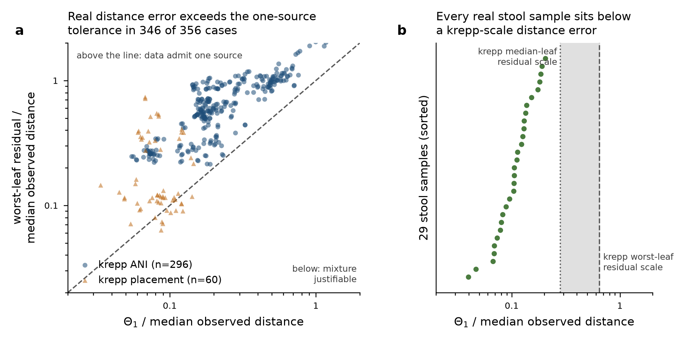

# Stage 298 - the real-data tolerance axis

`Theta_1` is the exact smallest tolerance at which a SINGLE source explains the
observations: the minimum over every original edge, and over the closed mass set
`{alpha, beta, y >= 0, alpha + beta = 1}`, of the largest absolute residual at an
observed reference leaf. It is a rational number computed from the distance data
alone - no error model, no ground truth, no admissible floor. Stage 296 proved
`m(eps) = min{k : Theta_k < eps}` for `eps > 0`, so the vector
`(Theta_1, Theta_2, ...)` fixes the whole tolerance axis.

**The question this answers for a practitioner: is my sample distinguishable from
a single source at all, given how accurate my distances are?** If the L-infinity
error of the pipeline that produced the distances exceeds `Theta_1`, then no
method - exact or heuristic - can justify reporting a mixture: the data admit a
one-source explanation within their own noise.

All three collections below are REAL measured distances. Every `Theta_k` is
decided by frozen stage-296 code; every attaining witness is re-verified with the
frozen `min(d(r,u) + xL, d(r,v) + (1-x)L)` form on the original tree.

## 1. The 29 travellers'-diarrhoea stool samples (real 16S, no ground truth)

Backbone: |E| = 21147 original edges, |R| = 10575 observed reference leaves, one
tree shared by all 29 samples; distances are DEPP placement estimates published
with the DecoDiPhy benchmark. `Theta_1` was computed exhaustively over every edge
TWICE - by the frozen per-support LP and by the stage-298 closed form - giving
613,263 independent agreements and 0 disagreements.

| sample | group | Theta_1 (obs. units) | Theta_1 / median obs. | attaining edge | terminal | x (closed form) |
|---|---|---|---|---|---|---|
| S6128 | TD | 12.11 | 0.0399 | 9318 (15233,15235) | no | 0.744 |
| S147 | TD | 14.343 | 0.0468 | 9318 (15233,15235) | no | 0.402 |
| S125 | TD | 20.511 | 0.0673 | 9084 (15116,15130) | no | 0.418 |
| S101 | TD | 20.848 | 0.0689 | 8600 (14874,15018) | no | 0.954 |
| S560 | HT | 21.4 | 0.0692 | 9084 (15116,15130) | no | 0.372 |
| S6163 | TD | 20.538 | 0.0735 | 20420 (20784,20812) | no | 0.299 |
| S3 | TD | 24.34 | 0.0787 | 8964 (15056,15078) | no | 0.598 |
| S715 | TD | 24.047 | 0.0804 | 8888 (15018,15035) | no | 0.145 |
| S160 | TD | 22.99 | 0.0827 | 20418 (20783,20784) | no | 0.452 |
| S50070 | TD | 26.637 | 0.0889 | 8888 (15018,15035) | no | 0.422 |
| S80142 | TD | 28.715 | 0.0957 | 8568 (14858,14874) | no | 0.663 |
| S50076 | TD | 29.053 | 0.105 | 20176 (20662,20664) | no | 0.657 |
| S10 | TD | 31.635 | 0.105 | 7800 (14474,14616) | no | 1 |
| S540 | HT | 32.091 | 0.106 | 8162 (14655,14858) | no | 0.246 |
| S510 | HT | 32.377 | 0.106 | 8600 (14874,15018) | no | 0.304 |
| S45 | TD | 33.718 | 0.112 | 8600 (14874,15018) | no | 0.999 |
| S80129 | TD | 36.597 | 0.113 | 9390 (15269,15273) | no | 0.563 |
| S6168 | TD | 36.595 | 0.123 | 8568 (14858,14874) | no | 0.323 |
| S78 | TD | 36.596 | 0.127 | 9390 (15269,15273) | no | 0.176 |
| S50395 | TD | 38.804 | 0.13 | 8568 (14858,14874) | no | 0.473 |
| S528 | HT | 41.041 | 0.131 | 7766 (14457,14474) | no | 0.794 |
| S523 | HT | 41.698 | 0.135 | 9432 (15290,15446) | no | 0.589 |
| S6165 | TD | 40.58 | 0.138 | 11826 (16487,16490) | no | 0.544 |
| S80152 | TD | 44.567 | 0.153 | 8083 (14616,14617) | no | 0.497 |
| S678 | TD | 48.503 | 0.175 | 17888 (19518,19854) | no | 0.677 |
| S521 | HT | 56.943 | 0.182 | 7740 (14444,14457) | no | 0.977 |
| S76 | TD | 54.741 | 0.186 | 16046 (18597,19490) | no | 0.905 |
| S156 | TD | 55.527 | 0.191 | 12104 (16626,17952) | no | 0.711 |
| S538 | HT | 66.433 | 0.205 | 5564 (13356,13420) | no | 0.276 |

Distribution over the 29 samples (min / Q1 / median / Q3 / max):

- `Theta_1` in observation units: 12.11 / 24.047 / 32.377 / 41.041 / 66.433
- `Theta_1` / median observed distance: 0.0399 / 0.0804 / 0.106 / 0.135 / 0.205
- median observed distance: 277.32 / 294.01 / 300.75 / 306.35 / 323.79
- attaining edge terminal (one endpoint a leaf) in 0 of 29 samples; 21 distinct
  attaining edges across the 29 samples.
- attaining witness independently verified in 29 of 29 samples.
- the attaining position need not be unique: `theta(S)` is a minimum over the
  CLOSED mass set, so it can be attained on a face.  The `x` column is the closed
  form's attaining position; the frozen LP may return a different point of the
  same optimal face, and in 14 of 29 samples the two differ while giving the
  identical exact `Theta_1`.  No travellers' witness places the source at an edge
  endpoint; 54 of 356 small-case k=1 witnesses do, and no witness anywhere carries
  zero mass.  This is expected and is why `m(eps)` uses a STRICT inequality: stage
  296 proved the strict system (`alpha, beta, y > 0`, hence `0 < x < 1`) is
  feasible for every `eps > theta(S)`, so a degenerate attainer at the threshold
  never enters an `m(eps)` verdict.

### Theta_2 on this backbone

Not affordable, and the cost is measured rather than estimated: 40 random
two-edge supports of sample `td_sample_101_published` under the frozen LP cost
0.638 s per support (min 0.467, max 1.031), and the exhaustive sweep is
C(21147, 2) = 223,587,231 supports, i.e. 39,594 core-hours for ONE sample.
Stage 296 showed the frozen structural localisation is unsound for `eps > 0`, so
the sweep cannot be pruned structurally, and incumbent pruning does not help
because the dominant cost is building each support's columns with the frozen BFS,
which happens before the LP decides anything. `Theta_2 <= Theta_1` always, so the
one-source statement below does not depend on it.

## 2. All 296 real krepp ANI cases

`krepp_estimated_10k`: real ANI distances estimated from reads, N = 20-128
reference leaves, K_true in {3, 5, 10}. Each case has an exact partner in the
bank - the model-implied distance vector for the same tree and the same
generating taxa - so the real estimation error is measurable in the same units as
`eps`: the L-infinity residual `max_r |d_est(r) - d_exact(r)|` on the shared leaf
set, which is stage 296's definition, applied here to all 296 cases (stage 296
measured 24 of them; the extension reproduces all 24 exactly).

| quantity (min / Q1 / median / Q3 / max) | krepp ANI (n=296) | krepp placement (n=60) |
|---|---|---|
| Theta_1 / median observed | 0.0549 / 0.157 / 0.19 / 0.355 / 1.17 | 0.0337 / 0.0672 / 0.0838 / 0.102 / 0.146 |
| Theta_2 / Theta_1 | 0.313 / 0.719 / 0.817 / 0.948 / 1 | 0.358 / 0.596 / 0.667 / 0.75 / 0.976 |
| Theta_3 / Theta_1 | 0.297 / 0.628 / 0.759 / 0.97 / 1 | 0.442 / 0.546 / 0.596 / 0.667 / 0.809 |
| residual (worst leaf) / median observed | 0.214 / 0.42 / 0.649 / 0.938 / 2.24 | 0.0634 / 0.106 / 0.121 / 0.34 / 0.736 |
| residual (median leaf) / median observed | 0.0365 / 0.15 / 0.282 / 0.483 / 1.72 | 0.0153 / 0.0452 / 0.0625 / 0.246 / 0.668 |
| worst-leaf residual / Theta_1 | 1.08 / 1.99 / 2.86 / 3.6 / 6.45 | 0.726 / 1.17 / 1.49 / 4.06 / 10.8 |
| median-leaf residual / Theta_1 | 0.12 / 0.729 / 1.59 / 2.36 / 4.43 | 0.175 / 0.496 / 0.769 / 2.75 / 9.85 |

**The headline count.** The real worst-leaf residual already exceeds `Theta_1` in
296 of 296 krepp ANI cases (100.0%) and in 50 of 60 placement cases (83.3%): at a
tolerance large enough to contain the measured error at EVERY leaf, the model's
own minimum is one source. Using the median-leaf residual instead - a tolerance
that contains only half the leaves' error - the count is 210 of 296 (krepp ANI) and
26 of 60 (placement).

`m(eps)` at `eps` = worst-leaf residual, krepp ANI: {"1:exact": 296}

`m(eps)` at `eps` = median-leaf residual, krepp ANI: {"1:exact": 210, "2:exact": 8, "3:exact": 10, "3:lower_bound": 58, "None:exhausted": 10}

(`k:exact` means `Theta_k < eps <= Theta_{k-1}` with both computed; `k:lower_bound`
means the sweep was censored at that k, so `m(eps) >= k`.)

**How much accuracy would move a sample off the collapsed side.** For the cases
whose worst-leaf residual exceeds `Theta_1`, the ratio residual / `Theta_1` is the
factor by which the pipeline's L-infinity distance error would have to shrink
before a mixture becomes justifiable at all: 1.08 / 1.99 / 2.86 / 3.6 / 6.45 (min / Q1 / median / Q3 / max)
for krepp ANI and 1.01 / 1.37 / 2.33 / 4.4 / 10.8 for placement.

By K_true, krepp ANI:

| K_true | n | Theta_1 / median obs. (median) | one source within worst-leaf residual |
|---|---|---|---|
| 3 | 100 | 0.182 | 100 |
| 5 | 100 | 0.207 | 100 |
| 10 | 96 | 0.193 | 96 |

## 3. The second real distance estimator: krepp placement distances

Outcome: **converted, 60 of 60 instances, 0 refused.**

The placement-distance tables sit in the Demixing_Data instance directories as
`distances_from_placement.txt` for 60 of the 656 instances (trees 15 and 17 only).
Conversion used the frozen stage-287 pipeline unchanged - `build_exact_case` for
the normal form, `attach_published_observed` for the observation vector, and
`verify_case` for conformance - plus strict positivity of every observed value.
All 60 converted cases carry byte-identical edges, leaf labels and generating
sources to the bank's exact case for the same instance, so their observations are
comparable leaf by leaf with the exact partner and with the ANI estimates.

One documented difference from the stage-287 krepp branch: that branch required
`set(published labels) == set(reference leaf labels)`. The placement files report
a distance for EVERY leaf of the tree, including the K query taxa the model turns
into interior sources and removes from the reference tree, so the published label
set is a strict superset. The rule applied here is containment - every reference
leaf must carry a positive placement distance - with the query-taxon entries
dropped, which the model requires because observations live at reference leaves
only. The dropped entries are exactly the K query taxa in 60 of 60 cases.

`truemash` remains unusable for the reason the gap audit records (every ANI tree
it produces carries negative branch lengths, so no PDD-conformant reference tree
exists); no reconstructed or repaired tree was substituted and no simulated noise
was used as a stand-in.

## 4. Where the travellers' samples sit

The travellers' samples have no exact partner, so their estimator error cannot be
measured from the data. Transferring the measured krepp relative error as a
REFERENCE SCALE (a different estimator on a different backbone - illustrative,
not a measurement of DEPP accuracy): the median krepp worst-leaf residual is
0.649 x the median observed distance and the median-leaf residual 0.282 x. Against
those two lines, 29 of 29 and 29 of 29 travellers' samples respectively have
`Theta_1` below the line - i.e. sit on the collapsed side, where the data admit a
one-source explanation. Moving a sample off that line needs the L-infinity
distance error reduced by a factor of 3.16 / 4.81 / 6.13 / 8.07 / 16.3 (min / Q1 / median / Q3 / max) relative
to the krepp worst-leaf scale.

## 5. Verification and censoring

- `Theta_k` cells completed: 978; failed: 0.
- k = 1 was run support by support with no cutoff on all 356 small real cases:
  40,544 edges compared between the frozen LP and the closed form, 0 disagreements.
- travellers: 613,263 edges decided twice, 0 disagreements.
- attaining witnesses re-verified with the frozen min(...) form: 859 of 859 agree.
- residual extension validated against stage 296: 24 of 24 rows agree exactly.
- censored cells: 90 ({"3": 90}), support cap {"1": 1000000000, "2": 1000000000, "3": 250000}; measured seconds per support 0.00148 / 0.00469 / 0.00583 / 0.00705 / 0.0134.

## 6. What this does NOT establish

- It does not give a source count for any real sample. The travellers' samples have no ground truth at all, and for the krepp and placement cases the generating taxa are known but the estimated distances are not exactly explainable by any configuration, so the minimum at tolerance zero is not the true count either.
- It does not measure the accuracy of DEPP placement distances. The travellers' axis is reported in the sample's own units; the krepp relative residual used in section 4 is a reference scale from a different estimator on a different backbone, not a measurement of this pipeline's error.
- It does not show that the samples ARE single-source. Theta_1 below the assay error means the data cannot JUSTIFY a mixture, not that no mixture is present; the one-source explanation is admissible, not identified.
- It says nothing about reference incompleteness on real data. Theta_1 is computed at the full reference panel only; the removal regimes of stages 288-294 were not run here.
- Theta_2 and Theta_3 are not available everywhere: 90 cells are censored by the registered support cap, and no Theta_2 exists for any travellers' sample. Where a cell is censored, m(eps) is reported as a lower bound, never interpolated.
- It does not compare against DecoDiPhy or any heuristic. The axis is a property of the model and the data; no method was run on these samples here.
- The krepp residual is measured against the model-implied distances for the known generating taxa on the positive-length reference tree. It is the error of the estimator relative to that configuration, and it inherits the bank's pairing choice (the authors' ANI branch-length trees carry negative lengths and are not PDD-conformant).

## 7. Figure

**(a)** Each point is one real case: its exact `Theta_1` against the measured
worst-leaf residual of the estimator that produced its distances, both divided by
that case's median observed distance. Points above the dashed identity sit on the
collapsed side - a tolerance containing the real error at every leaf already
admits a one-source explanation. **(b)** The 29 travellers' samples have no
measurable residual, so their `Theta_1` is shown against the krepp relative-error
scale (dotted: median-leaf, dashed: worst-leaf) as a reference from a different
estimator, not a measurement of DEPP accuracy.

## 8. Files

- `results/stage298/stage298_protocol.json` - protocol, registered before any timed run
- `results/stage298/stage298_placement_manifest.json` - placement conversion, per-instance outcome and hashes
- `results/stage298/stage298_sweep_runs.jsonl` - every Theta_k run on the 356 small real cases
- `results/stage298/stage298_sweep_censored.json` - every censored (case, k) cell with its support count
- `results/stage298/stage298_td_runs.jsonl` - every travellers' edge-chunk run
- `results/stage298/stage298_td_summary.json` - per-sample travellers' result and witness verification
- `results/stage298/stage298_td_k2_cost.json` - measured cost of Theta_2 on the travellers' backbone
- `results/stage298/stage298_residuals.json` - real estimation residuals, all 356 cases
- `results/stage298/stage298_analysis.json` - assembled axis
- `results/stage298/stage298_witness_degeneracy.json` - degeneracy census of the attaining witnesses
- `results/stage298/stage298_protocol_amendment.json` - post-registration code hashes
- `results/stage298/stage298_real_data_axis.png` - the figure
- `data/stage298_placement/cases/` - 60 converted placement cases
