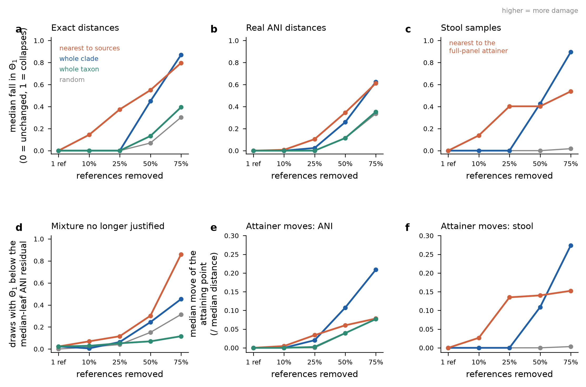

# Stage 299 — Reference incompleteness on real estimated distances

**The loop this closes.** Every reference-incompleteness measurement in this project (stages 288-295)
runs on instances with synthetic planted sources, and needs either ground truth or an admissible
pendant floor. Stage 298 built an instrument that needs neither — $\Theta_1$, the exact smallest
tolerance at which a **single** source explains the observations — but ran it only at the full
reference panel, and said so. Stage 299 runs the stage-288 removal regimes through that instrument on
four collections, which makes this the project's first real-data incompleteness measurement.

$\Theta_1$ is the minimum over every original edge $e$, and over the closed mass set
$\{\alpha,\beta,y\ge 0,\ \alpha+\beta=1\}$, of $\max_r |\mathrm{pred}_r - d_r|$. It is a rational
number computed from the data alone: no error model, no ground truth, no floor.

| arm | collection | $|R|$ | leaf sets |
|---|---|---|---|
| `exact_partner` | the 296 `exact_10k` partners, on the krepp panel and the identical leaf sets — the **paired** exact-model baseline | 20-128 | 10,656 |
| `krepp_ani` | the 296 krepp ANI cases (real $k$-mer distance estimates) | 20-128 | 10,656 |
| `krepp_placement` | the 60 krepp placement cases converted in stage 298 | 20-128 | 2,160 |
| `travelers` | the 29 travellers'-diarrhoea stool samples, DEPP placement distances on a 21,147-edge 16S backbone, **no ground truth** | 10,575 | 754 |

Draws are imported from `stage288_incompleteness.removal_draws` — same seed (2880003), same five
levels, same regimes — with stage 294's convention that the random seed key uses the paired *exact*
case name, so the exact, ANI and placement arms share leaf sets leaf for leaf. The import was verified
before any timed run: on all 1,350 random draws of the 135 cases whose krepp panel equals its exact
panel, the draws reproduce stage 288 element for element, and all 296 generating-source sets are
identical between partners. Stage 294's taxonomic regime (Web of Life NCBI ranks, genus or species)
is carried along as the one regime a practitioner actually experiences.

## Verification ledger

Nothing here is decided by new code.

| check | result |
|---|---|
| leaf sets run / complete | 24,226 / 24,226 (0 failures, 0 timeouts) |
| edges decided twice (frozen per-support LP vs stage-298 closed form), small arms | 2,638,368 — **0 disagreements** |
| frozen-LP spot checks on the travellers' backbone (attaining edge + 20 seeded edges per leaf set) | 15,831 — **0 disagreements** |
| attaining witnesses re-verified with the frozen $\min(d(r,u)+xL,\ d(r,v)+(1-x)L)$ form | 24,226 / 24,226 agree exactly |
| full-panel $\Theta_1$ equals stage 298's recorded value | 385 / 385 (and the attaining edge agrees in 29/29 travellers' samples) |
| **monotonicity check** (removal deletes LP rows, so $\Theta_1$ can only fall) | 0 rises in 23,545 draws — no bug to report |
| geometry of the attaining point validated against subdivision + the frozen BFS | 126 / 126 distances, 126 / 126 hop counts |
| closed form vs frozen LP on hard thinnings (up to 80 one-sided edges) and a synthetic star | 8 / 8 leaf sets, 0 edge mismatches |

Monotonicity is reported as a check, not a finding: it is the same theorem as before.

## 1. Does the regime ordering survive on real estimated distances? — Yes

*(a-c) median fall in $\Theta_1$ relative to the same case's full-panel $\Theta_1$, by removal level and
regime; 0 means $\Theta_1$ is unchanged, 1 that it collapses to zero. (a) and (b) are the same 296 trees
and the same leaf sets, exact distances vs real ANI distances. (d) fraction of krepp ANI draws whose
$\Theta_1$ has fallen below the median-leaf ANI residual recomputed on the retained references, over the
86 of 296 cases that start above that line. (e-f) median tree-path distance between the full-panel
attaining point and the post-removal attaining point, in units of the case's own median observed
distance. The taxonomic regime removes whole groups, so its achieved removal undershoots the nominal
level (median 0.733 at the 75% level on the krepp trees, 0.386 on the placement trees); read it against
its achieved fraction, not the axis tick.*

Median fall in $\Theta_1$ (1 − $\Theta_1^{\text{draw}}/\Theta_1^{\text{full}}$), and the ratio to the
random regime at the same level:

| arm | level | random | whole clade | nearest to sources | whole taxon |
|---|---|---|---|---|---|
| exact (paired) | 50% | 0.069 | 0.449 (**6.5×**) | 0.550 (**7.9×**) | 0.133 (1.9×) |
| exact (paired) | 75% | 0.303 | 0.870 (**2.9×**) | 0.796 (**2.6×**) | 0.394 (1.3×) |
| krepp ANI | 50% | 0.114 | 0.259 (**2.3×**) | 0.346 (**3.0×**) | 0.115 (1.0×) |
| krepp ANI | 75% | 0.336 | 0.625 (**1.9×**) | 0.613 (**1.8×**) | 0.354 (1.1×) |
| krepp placement | 50% | 0.128 | 0.327 (**2.6×**) | 0.277 (**2.2×**) | 0.000 (—) |
| krepp placement | 75% | 0.253 | 0.531 (**2.1×**) | 0.500 (**2.0×**) | 0.029 (0.1×) |
| stool samples | 50% | 0.000 | 0.427 (—) | 0.403 (—) | n/a |
| stool samples | 75% | 0.018 | 0.896 (**50×**) | 0.538 (**30×**) | n/a |

The exact-model ordering — whole clade and nearest-to-sources roughly 2-4× worse than random —
**survives on real estimated distances**, at 1.8-3.0× on the krepp ANI arm and 2.0-2.6× on the
placement arm, against 2.6-7.9× in the paired exact arm on the same trees and the same draws. The
effect is attenuated by estimation error but not reversed, and not washed out.

Two findings sharpen this.

1. **On a large real panel the contrast is far larger, not smaller.** On the 10,575-reference 16S
   backbone, removing half the references at random leaves the median $\Theta_1$ at
   0.9999999999999936 of its full-panel value, and removing three quarters leaves it at 0.982 — a 1.8%
   cost for losing 7,931 references. Removing a comparable number as whole clades costs 90%. This is
   the stage-290/292/297 panel-size result appearing on real data: a bigger database buys protection
   against random loss and none at all against structured loss.
2. **The regime a practitioner actually faces is the weakest one.** Whole-taxon removal is
   indistinguishable from random on the krepp ANI arm (1.0-1.1×) and *below* random on the placement
   arm, partly because whole-group granularity undershoots the nominal level. Taxonomic reference gaps,
   as this benchmark can express them, do not behave like the adversarial regimes.

An independent exact-model comparator agrees: re-analysing stage 296's 1,075 frozen draws on 43 other
exactly explainable cases (no new runs) gives, at 75% loss, a median fall of 1.000 for whole clade,
0.878 for nearest and 0.479 for random — ratios of 2.1× and 1.8×, with 0 rises.

## 2. Dose-response: how much loss before the data stop justifying a mixture

The estimator's measured residual against its exact partner is the tolerance the data already carry.
Where $\Theta_1$ is below it, one source explains the observations within the measurement error and the
data no longer justify a mixture at all. Two lines are reported — the worst-leaf and the median-leaf
residual — each recomputed on the **retained** references (primary; it is what a practitioner at the
reduced panel faces) and fixed at the full panel (secondary). Cases already below a line at the full
panel are excluded from that line's dose-response and counted.

* **Worst-leaf line, krepp ANI: there is no dose-response, because all 296 of 296 cases are already
  below it at the full panel.** Stage 298 reported this; stage 299 reproduces it independently as the
  exclusion count. The honest statement is that reference loss cannot be measured against this line
  on this collection.
* **Median-leaf line, krepp ANI:** 210 of 296 cases start below it; 86 remain. Fraction of draws that
  cross, by level:

| regime | 1 ref | 10% | 25% | 50% | 75% |
|---|---|---|---|---|---|
| nearest to sources | 0.02 | 0.07 | 0.12 | 0.30 | **0.86** |
| whole clade | 0.02 | 0.01 | 0.06 | 0.24 | 0.45 |
| random | 0.00 | 0.02 | 0.04 | 0.15 | 0.31 |
| whole taxon | 0.02 | 0.03 | 0.05 | 0.07 | 0.12 |

  Per case, the median first-crossing level is 75% loss under nearest-to-source removal (74 of 86
  cases cross by then, 12 never do within the grid) and **never** under random loss (50 of 86 never
  cross).
* **krepp placement, worst-leaf line:** 50 of 60 start below; of the 10 that remain, 80% of whole-clade
  draws and 60% of nearest draws cross by 75% loss, against 45% random and 15% taxon. Median-leaf line:
  26 of 60 start below; of the 34 remaining, 62% clade / 26% nearest / 24% random / 10% taxon cross by
  75%.
* The travellers' samples have no exact partner, so they carry **no** dose-response. Reporting one
  would require inventing an error model.

## 3. Does the attaining edge move?

Stage 293 found that in the exact model reference loss takes source *position* before abundance. The
real-data analogue holds, and it is visible before the magnitude moves:

| arm | regime | same edge at 25% loss | same edge at 75% | median move at 75% (/ median distance) | median hops at 75% |
|---|---|---|---|---|---|
| exact (paired) | random | 0.840 | 0.459 | 0.026 | 0 |
| exact (paired) | whole clade | 0.655 | 0.062 | 0.136 | 3 |
| krepp ANI | random | 0.814 | 0.390 | 0.077 | 0 |
| krepp ANI | whole clade | 0.590 | 0.130 | 0.209 | 3 |
| stool samples | random | 0.931 | 0.759 | 0.003 | 0 |
| stool samples | whole clade | 0.724 | 0.000 | 0.274 | 22 |
| stool samples | nearest to attainer | 0.241 | 0.034 | 0.152 | 7 |

On the stool samples, random removal of three quarters of the panel leaves the attaining edge unchanged
in 76% of draws and moves the attaining point by 0.3% of a median observed distance; whole-clade removal
of the same number moves it to a different edge in **every** draw, a median of 22 edges away. Under
nearest-to-attainer removal the edge has already changed in 76% of draws at 25% loss while the median
fall in $\Theta_1$ is 0.40 — position goes first, as in the exact model.

**The attaining edge is never terminal on the stool samples** — 0 of 29 at the full panel (stage 298's
finding, reproduced) and 0 of 754 across every level and regime. The best single-source explanation of a
real stool sample never sits on a pendant branch, however much of the reference panel is removed. On the
krepp ANI trees the terminal fraction is 15.5% at the full panel and rises to 31.2% at 75% whole-clade
loss.

Magnitude, for scale: the median $\Theta_1$ is 0.190 of the case's own median observed distance on krepp
ANI at the full panel, 0.106 on the stool samples, and 0.070 on the paired exact arm; at 75% whole-clade
loss these fall to 0.089, 0.010 and 0.009.

## 4. Paired exact vs estimated, same leaf sets

Over the 10,360 draws where the exact and ANI arms ran the identical leaf set of the identical tree:
both arms' $\Theta_1$ falls in 4,182, neither in 4,066, the exact arm only in 985, the ANI arm only in
1,127. **Neither arm ever rises** — monotonicity is a theorem on both. So estimation error changes
*which* draws register a fall, not the direction of the effect.

That is the contrast with the published heuristic. Stage 294 found that DecoDiPhy's inferred count on
real ANI distances falls in 36.1% of draws but **rises in 20.9%**, and that the structured/random
ordering inverts (ratios 0.54 clade, 0.80 nearest against 2.39 and 2.88 in the exact arm). Measured
with a quantity that is defined on real data, the same real distances preserve both the one-sidedness
and the ordering. The thesis is not unobservable in practice; it is unobservable *through a point
estimate of $k$*.

## What this does not establish

* **No source count is claimed for any real sample.** $\Theta_1$ is a tolerance, not a count. A
  statement of the form "this sample has $k$ sources" would need $\Theta_2,\Theta_3,\dots$, which stage
  298 measured at 39,594 core-hours per sample on the travellers' backbone and did not run.
* $\Theta_2$ and above are not computed anywhere in this stage, at any panel size. The dose-response
  therefore says when the data stop *justifying* a mixture, never how many sources a mixture has.
* The travellers' arm has **no ground truth and no estimator residual**: no dose-response, and its
  nearest-to-source regime is anchored on the data's own full-panel attaining point
  (`nearest_theta1`), not on true sources. It is not comparable draw-by-draw with the truth-based
  `nearest` of the other arms, and it is never pooled with it.
* The worst-leaf dose-response on krepp ANI is **empty by saturation**, not by absence of effect: all
  296 cases start below that line.
* The taxonomic regime is limited to genus and species by panel breadth (stage 294); removal of whole
  families, orders or phyla remains untestable on this benchmark, and its achieved removal fraction
  undershoots the nominal level, most severely on the placement trees (0.386 at the 75% level).
* Migration is measured at the LP-verified attaining point. Where the minimising position *within* an
  edge is not unique, the two independent implementations choose different points of the optimal
  interval: they agree on the attaining $x$ in 11,930 of 23,472 small-arm leaf sets while agreeing on
  $\Theta_1$ in 23,472 of 23,472. The edge-level statistics (same-edge fraction, hop counts) carry no
  such ambiguity; the sub-edge component of the distance does.
* The placement collection is 60 cases and the travellers' collection 29 samples; the stool samples are
  one study, one backbone, one placement method.
* Nothing here revisits stage 291's inadmissible pendant floor, and no bound of that kind is used.

## Files

Under `results/stage299/` on the server:

* `stage299_protocol.json` — the registered protocol: all 24,226 leaf sets with their removed-reference
  lists, draw-plan digest `91a666ca0f94e5...`, input hashes for 681 case files, code hashes, budgets
  and the claims above, registered before any timed run.
* `stage299_small_runs.jsonl` (23,472 records) and `stage299_td_runs.jsonl` (754) — every run retained,
  each with both decisions, the attaining set, the witness and the independent deviation.
* `stage299_analysis.json` — the ledger, the 75-cell arm x level x regime table, dose-response,
  migration and the paired contrast. `stage299_per_draw.csv` — one row per draw.
* `stage299_exact_baseline.json` — stage 296's 1,075 frozen draws re-analysed on the same statistic.
* `stage299_validation{,_v2,_v3}.json` — the geometry and closed-form validation. v1 and v2 are
  retained and failed: three geometry disagreements, both times a defect in the validator's own
  reference computation for a point pair on the *same* edge (one inserted vertex in v1; a handle dict
  keyed by edge index, which collides, in v2). `point_distance` was correct throughout and is
  unchanged; v3 passes 126/126.
* `stage299_regime_ratios.json` — the structured/random ratios of the table above, derived
  deterministically from `stage299_analysis.json`; ratios suppressed where the random median fall
  is zero. `stage299_real_incompleteness.{md,png}` — this report and its figure.
* `stage299_protocol_amendment.json` — the three scripts that changed after registration, with
  before/after hashes and why none of them decides a $\Theta$: the validator's same-edge reference
  defect (v1, v2), the exact-arm panel restriction (which aborted on its own assertion before
  writing any record), and two optional-key fixes in analysis code.
* `scripts/stage299_{common,protocol,validate,small,td,exact_baseline,analyze,amendment}.py`.
